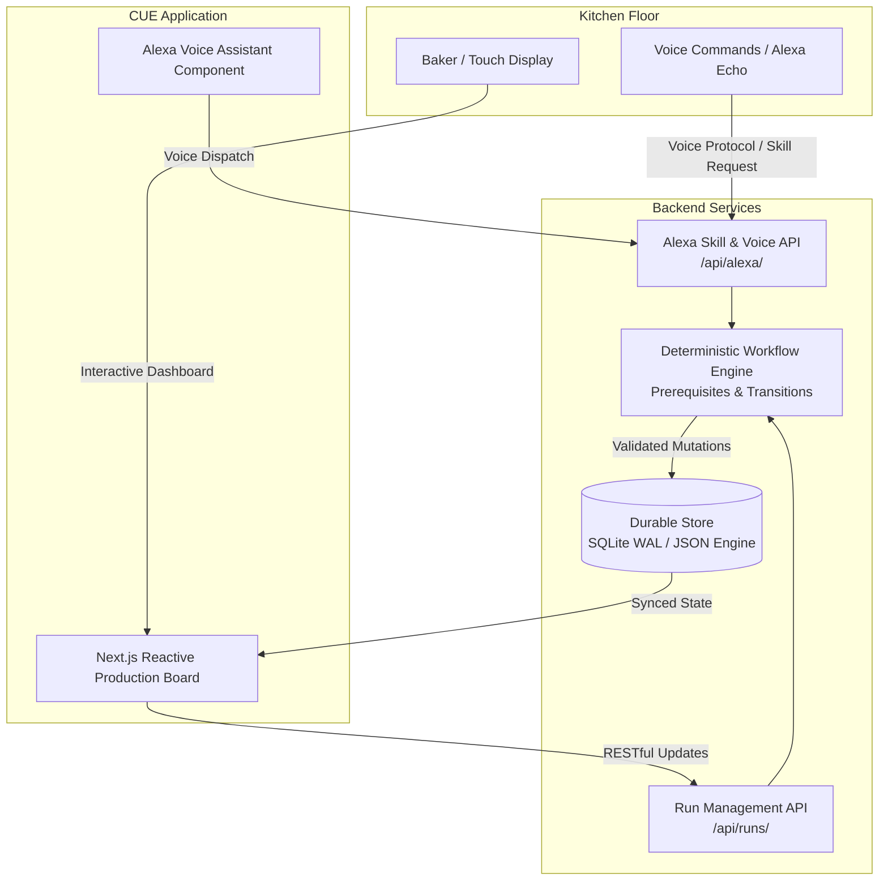
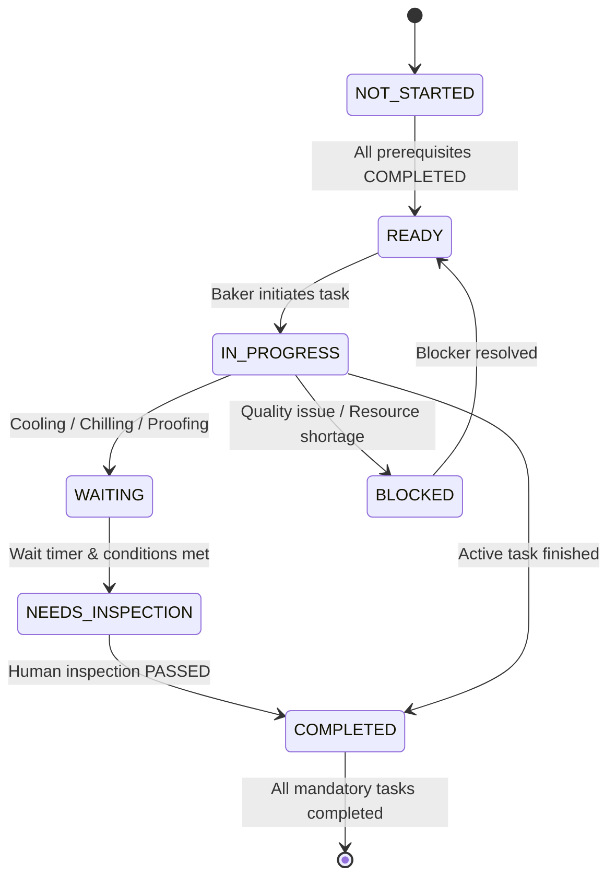

# CUE — Confirmed Updates & Execution

*Your next step, right on cue.*

CUE is a workflow-aware baking production assistant designed for commercial bakeries and independent culinary facilities. It pairs a hands-free **Alexa-powered voice assistant** with a **real-time visual production board**, enabling bakers with messy, flour-covered hands to monitor batch statuses, inspect waiting stages, and execute validated task transitions without touching a screen.

---

## Executive Summary

In commercial and craft bakery operations, tracking complex, multi-stage production across parallel batches (mixing, proofing, baking, chilling, inspecting, and packaging) is prone to interruptions and costly record-keeping lag. 

**CUE solves this by coordinating recorded workflow state with deterministic rules and two-phase confirmed updates:**
- **Hands-Free Kitchen Operations**: Full Amazon Alexa Custom Skill integration and web-based voice interface for real-time status queries and task proposals.
- **Dependency-Aware Production Board**: Visual status across active batches, automatically recalculating downstream readiness as prerequisites complete.
- **Safety-First Confirmation Guard**: Critical updates, inspections, and batch transitions require explicit two-phase confirmation with snapshot versioning to eliminate race conditions and mistakes.
- **Full-Stack Production Backend**: Resilient RESTful API with SQLite persistence, automatic serverless fallback, and comprehensive test coverage.

---

## System Architecture



### Architectural Highlights

1. **Deterministic Workflow Engine** (`src/lib/workflow.ts`):
   - Enforces linear and parallel prerequisites.
   - Prevents invalid transitions (e.g., jumping from `NOT_STARTED` to `COMPLETED`).
   - Requires physical human inspection confirmation for quality-critical waiting stages (cooling, chilling, proofing).
   - Prevents reopening completed steps if subsequent dependent work has progressed.

2. **Durable Persistence Layer** (`src/lib/backend-store.ts`):
   - **Native SQLite (WAL Mode)**: High-performance, concurrent disk storage for local server and edge deployments.
   - **Automatic Serverless Fallback**: Transparently provides file/memory JSON persistence if native C++ bindings are omitted on serverless platforms (Vercel, Cloudflare Pages), ensuring zero 500 downtime.

3. **Two-Phase Action Proposals** (`src/lib/cue-api.ts`):
   - Actions first enter a `PENDING` state with an attached snapshot version.
   - If concurrent changes occur before confirmation, stale actions are safely invalidated.

---

## Production Features

| Feature | Description | Status |
| :--- | :--- | :--- |
| **Interactive Production Board** | Visual batch cards showing progress percentage, current stage, eligible tasks, active waits, and blockers. | **Production Ready** |
| **Alexa Voice Assistant** | Amazon Alexa Custom Skill endpoint + web voice client with real-time speech and visual response cards. | **Production Ready** |
| **Batch Management CRUD** | Create new production runs (`POST /api/runs/`), inspect individual batches (`GET /api/runs/[id]/`), and remove completed runs (`DELETE /api/runs/[id]/`). | **Production Ready** |
| **Status Telemetry API** | Live calculation of completion percentages, ready task counts, active waits, blocked items, and inspection queues. | **Production Ready** |
| **Wait & Inspection Tracking** | Dedicated tracking for cooling, chilling, and baking waits with explicit physical check sign-offs. | **Production Ready** |
| **Multi-Product Catalog** | Pre-configured workflows for Chewy Pistachio Crunchies, Biscoff Cheesecake, and Belgian Chocolate Chip Cookies. | **Production Ready** |

---

## API Reference

All endpoints return JSON and are hosted at `/api/*`.

### 1. Health & Service Diagnostics
- **`GET /api/health/`**: Returns service status and liveness confirmation.
- **`POST /api/health/`**: Verifies backend write access and active run telemetry.

### 2. Production Runs
- **`GET /api/runs/`**: Lists all active production runs, current operator, and pending proposals.
- **`GET /api/runs/stream/`**: Real-time Server-Sent Events (SSE) stream broadcasting live batch updates, pending proposals, and confirmations to all connected kitchen screens.
- **`POST /api/runs/`**: Initializes a new production batch.
  ```json
  // Request
  {
    "productId": "product-cookies",
    "quantity": 24,
    "runType": "customer-order",
    "owner": "lead-baker"
  }
  ```

### 3. Single Run Management
- **`GET /api/runs/:id/`**: Retrieves full batch state, task list, prerequisites, and audit history.
- **`DELETE /api/runs/:id/`**: Terminates and removes the specified production run and any open pending actions.

### 4. Status Telemetry
- **`GET /api/runs/:id/status/`**: Returns computed real-time status:
  ```json
  {
    "ok": true,
    "runId": "CUE-001",
    "status": "IN_PROGRESS",
    "summary": {
      "completionPercent": 43,
      "eligibleCount": 1,
      "waitingCount": 1,
      "blockedCount": 0,
      "inspectionCount": 1
    }
  }
  ```

### 5. Task Workflow Proposals & Confirmations
- **`POST /api/runs/:id/propose/`**: Proposes a state transition for a task:
  ```json
  {
    "taskKey": "cook-main",
    "nextState": "IN_PROGRESS",
    "reason": "Oven loaded and preheated to 350°F.",
    "actionType": "transition"
  }
  ```
- **`POST /api/runs/:id/confirm/`**: Confirms or cancels a pending action:
  ```json
  {
    "pendingId": "pending-12345",
    "confirm": true
  }
  ```

### 6. Alexa Voice Skill Endpoint
- **`GET /api/alexa/`**: Returns supported intents and sample commands.
- **`POST /api/alexa/`**: Handles incoming Amazon Alexa skill JSON payloads and direct natural language text commands:
  ```json
  // Direct voice command
  { "command": "Alexa, what is the status of CUE-001?" }

  // Alexa Custom Skill format
  {
    "request": {
      "type": "IntentRequest",
      "intent": { "name": "GetReadyTasks" }
    }
  }
  ```

---

## Alexa Voice Commands Reference

| Intent | Sample Voice Utterances | Alexa Response Behavior |
| :--- | :--- | :--- |
| **GetStatus** | *"Alexa, what is the status?"*<br/>*"Alexa, what is the status of CUE-001?"* | Reports batch completion percentage, active wait conditions, and completed task tallies. |
| **GetReadyTasks** | *"Alexa, what can I do next?"*<br/>*"Alexa, what tasks are ready?"* | Identifies all tasks whose prerequisites are complete and ready for immediate pickup. |
| **GetWaitingTasks** | *"Alexa, what is waiting?"* | Lists components currently in cooling, chilling, or proofing with elapsed duration and inspection requirements. |
| **BlockerInquiry** | *"Alexa, why is cook-main blocked?"* | Diagnoses unmet prerequisite dependencies or recorded quality flags. |
| **InspectionSignoff** | *"Alexa, mark the inspection complete."* | Verifies human inspection criteria and prepares the completion proposal. |
| **SwitchRun** | *"Alexa, switch to CUE-002."*<br/>*"Alexa, focus on pistachio batch."* | Switches active visual focus on the production board to the requested batch. |
| **ProposeTaskUpdate**| *"Alexa, start cook-main."* | Enforces workflow checks and puts forward a verified transition proposal for board confirmation. |

---

## Workflow Task States



---

## Getting Started

### Prerequisites
- **Node.js**: v20.9.0 or higher
- **pnpm**: v10.34.3 (pinned)

### Local Setup

1. **Clone and install dependencies**:
   ```bash
   git clone https://github.com/ACJ08/Cue.git
   cd Cue
   pnpm install
   ```

2. **Start the development server**:
   ```bash
   pnpm run dev
   ```
   Open [http://localhost:3000](http://localhost:3000) in your browser.

3. **Run the automated test suite**:
   ```bash
   pnpm test
   ```
   All 25 core workflow and storage unit tests will execute.

4. **Verify TypeScript compilation**:
   ```bash
   pnpm run typecheck
   ```

---

## Deployment Options

### Vercel (Recommended)
CUE is pre-configured for Vercel with Next.js App Router:
- Push to `main` branch to trigger automatic zero-config deployments.
- In-memory/filesystem JSON persistence handles stateless serverless execution seamlessly.

### Cloudflare Pages
- Preset: `Next.js (Static HTML Export)`
- Build command: `pnpm run build`
- Output directory: `out`
- Deploy command: `pnpm run deploy`

---

## Technology Stack

- **Framework**: Next.js 16 (App Router)
- **UI & Components**: React 19, Tailwind CSS v4, Lucide Icons
- **Language**: TypeScript 5.7+
- **Persistence**: SQLite (better-sqlite3) with resilient JSON fallback
- **Voice Protocol**: Alexa Skills Kit (ASK) Custom Skill specification
- **Testing**: Node.js native test runner (`tsx --test`)
- **Code Quality**: Oxfmt, TypeScript strict mode

---

## License

This project is licensed under the MIT License. See [LICENSE](LICENSE) for details.
